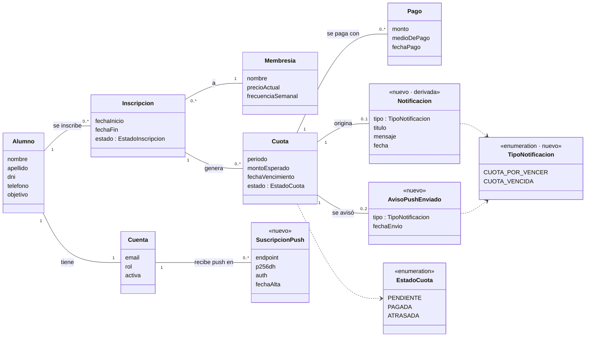
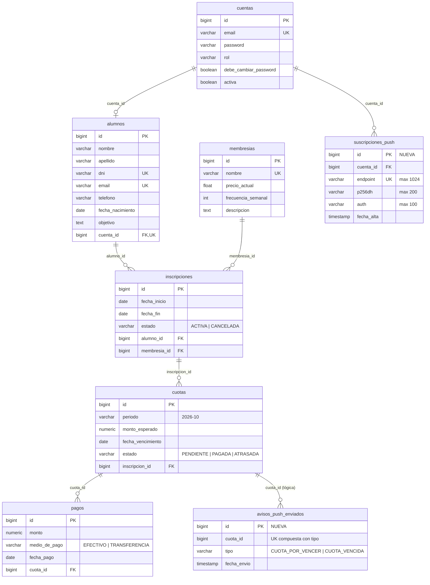

# HU-250 — Notificaciones de cuota: MOD y DER

Modelo de dominio (MOD) y diagrama entidad-relación (DER) de lo que agrega la HU-250: notificaciones de
cuota dentro de la app y notificaciones push al celular.

Los diagramas incluyen, como contexto, las entidades existentes con las que se relaciona lo nuevo
(Cuenta, Alumno, Inscripción, Membresía, Cuota y Pago). **Lo nuevo de esta HU está marcado con «nuevo».**

| Elemento nuevo | ¿Se guarda en la base? | Para qué |
|---|---|---|
| Notificación | **No** (se calcula) | Aviso que ve el alumno: cuota "por vencer" o "vencida" |
| Suscripción push | Sí — tabla `suscripciones_push` | Dispositivo (celular/compu) que aceptó recibir push |
| Aviso push enviado | Sí — tabla `avisos_push_enviados` | Registro de que ya se mandó la push de una cuota en un estado |

---

## 1. MOD — Modelo de dominio

### Reglas del dominio

- **Notificación (derivada):** no se guarda, se calcula a partir del estado de la cuota cada vez que el alumno
  la consulta. Por eso cada cuota tiene **como máximo una** notificación (0..1):
  - `CUOTA_POR_VENCER`: cuota `PENDIENTE` que vence en 5 días o menos (mismo umbral que HU-46).
  - `CUOTA_VENCIDA`: cuota `ATRASADA`, o `PENDIENTE` con la fecha de vencimiento ya pasada.
  - Cuota `PAGADA`: no tiene notificación → desaparece sola al registrar el pago.
- **Suscripción push:** pertenece a la **cuenta** (no al alumno), porque es de quien inicia sesión en ese
  dispositivo. Una cuenta puede tener varios dispositivos. Si otra cuenta inicia sesión en el mismo
  dispositivo, la suscripción pasa a esa cuenta. Al cerrar sesión se elimina.
- **Aviso push enviado:** una cuota se avisa al celular **una sola vez por estado**, así que tiene como máximo
  dos avisos: uno al pasar a "por vencer" y otro al pasar a "vencida" (0..2).

---

## 2. DER — Diagrama entidad-relación

### Tablas nuevas

#### `suscripciones_push`

| Columna | Tipo | Restricciones | Descripción |
|---|---|---|---|
| `id` | bigint | PK, autoincremental | |
| `cuenta_id` | bigint | FK → `cuentas.id`, NOT NULL | Cuenta que recibe las push en este dispositivo |
| `endpoint` | varchar(1024) | NOT NULL, UNIQUE | URL del servicio de push del navegador (Google, Apple, Mozilla) para este dispositivo |
| `p256dh` | varchar(200) | NOT NULL | Clave pública del dispositivo, para cifrar el mensaje |
| `auth` | varchar(100) | NOT NULL | Secreto del dispositivo, también para el cifrado |
| `fecha_alta` | timestamp | NOT NULL | Cuándo se activaron (o se reactivaron) las push |

#### `avisos_push_enviados`

| Columna | Tipo | Restricciones | Descripción |
|---|---|---|---|
| `id` | bigint | PK, autoincremental | |
| `cuota_id` | bigint | NOT NULL, UNIQUE (`cuota_id`, `tipo`) | Cuota avisada. Referencia lógica a `cuotas.id`: se guarda el id, sin FK en la base |
| `tipo` | varchar(30) | NOT NULL, UNIQUE (`cuota_id`, `tipo`) | `CUOTA_POR_VENCER` o `CUOTA_VENCIDA` |
| `fecha_envio` | timestamp | NOT NULL | Cuándo se mandó la push |

La restricción única (`cuota_id`, `tipo`) es la que garantiza que una cuota no se avise dos veces en el mismo
estado, aunque la tarea diaria de las 10:00 la vuelva a encontrar.

### Tablas existentes

No se modificó ninguna tabla existente. Las dos tablas nuevas las crea Hibernate al arrancar el backend
(`spring.jpa.hibernate.ddl-auto=update`).
